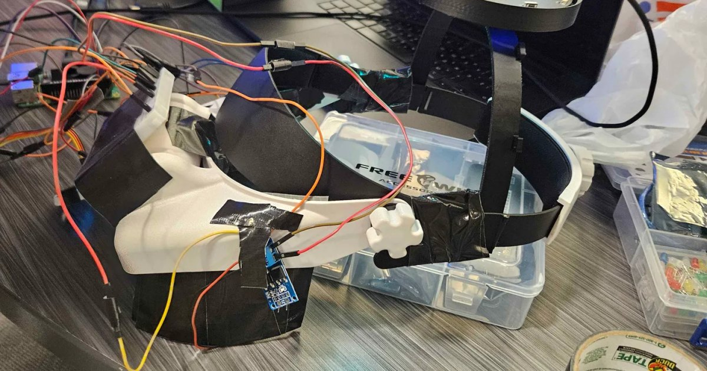
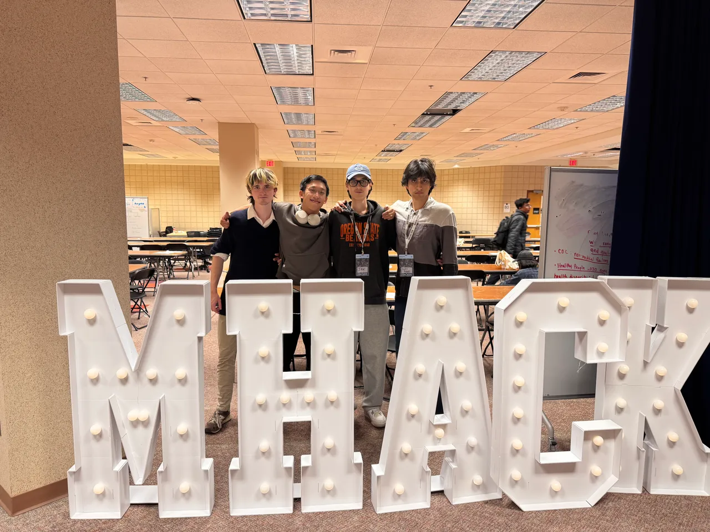

# Usher: the "Hello Jax" headset

A headset for people with Usher syndrome: say "Hello Jax", and it turns the wearer toward you.

Built at [MHacks 2026](https://www.mhacks.org), University of Michigan, October 3-4, 2026, by a team of four. Project page: [Devpost](https://devpost.com/software/usher).



## What it does

Usher syndrome combines hearing loss with a field of view that narrows to a tunnel, so the wearer cannot hear which way a voice came from and cannot see the speaker unless they are straight ahead. When someone says a greeting followed by the wearer's name ("Hello Jax"), a four-mic array on the headset works out where the voice came from. A soft buzz on one temple tells the wearer which way to turn and fades as they face the speaker, and a small OLED shows LEFT, RIGHT, FRONT or BEHIND. Live captions show what people are saying, with an arrow toward whoever is talking, and a "catch me up" view shows what the caller just said. The wake path (detection, buzz, arrow) runs on the Raspberry Pi and works offline.

## Demo

- Clips from the judging table and the judge web app: [case study](https://www.tynshimov.com/work/usher/)
- The judge web app has a scripted demo mode that needs no headset: open `frontend/index.html` and press **Try demo** ([frontend/README.md](frontend/README.md)).

## Team



- **Jakhangir Tynshimov (team lead, my part):** the idea and the research behind it (what people with Usher syndrome struggle with, which aids exist and where each one fails); the hardware: bringing and wiring the reSpeaker array, the Pi and the motor modules; through the night, a review of the team's code (16 findings with patches), an offline test harness of 144 checks, and the runbook used at the judging table.
- **Oliver Lai:** wrote most of the program on the Pi and tested it on the device.
- **Sajjad Akbari:** built the web page and the camera server.
- **Matthew Palmer:** modelled and printed the headband and the mic tray.

## How it works

```
reSpeaker XVF3800 mic array ──► direction (DOA + on-chip speech flag, averaged over the phrase)
   │
   ├─ ch2 ──► rolling 4 s window ──► Whisper (tiny.en, on the Pi) ──► "hello" + "Jax"?
   │                                                                     │
   │                          temple motors (soft buzz toward them, fades as you face them) ◄─┤
   │                          OLED arrow (LEFT / RIGHT / FRONT / BEHIND)     ◄─┤
   │                          catch-up: last 30 s → ElevenLabs Scribe (voice ID) → what the caller said
   │
   └─ ch0 ──► ElevenLabs Scribe Realtime ──► live captions on the OLED (+ arrow toward who is talking now)
                                         └─► also spots "Hello Jax" ~0.2 s after it's said (faster wake, same rule)

server.py ──► WebSocket :8765 ──► judge web app (captions, voice-ID lines, Gemini summary, sound events)
camera_server.py ──► http://<pi>:8081/ (headset camera + serves the web app)
```

Only the greeting plus the name triggers the motors; the name on its own does not. "Hello Jax" (detection, arrow,
motors) runs entirely on the Pi and works offline (Whisper). Captions, catch-up, Gemini and the faster ElevenLabs
wake need internet and API keys, and none of them sits in the buzz path.

Judge web app (`frontend/`): open `http://<pi>:8081/` with `server.py` and `camera_server.py` running. Left: the
headset camera with a tunnel-vision overlay; right: a voice-identified transcript (batch Scribe, `refine.py`) and a
Gemini summary. Details: [frontend/README.md](frontend/README.md).

Measured on the hardware during the night (one room, one team and a hotspot; not a benchmark):

| | |
|---|---|
| "Hello Jax" to the arrow | 1-2 s (Whisper on the Pi 5) |
| Direction error after calibration | 3-11°, about 20 readings a second |
| Catch-up, 30 s of audio | 0.6-2.4 s round trip |

### Hardware

- Raspberry Pi 5
- Seeed reSpeaker XVF3800 USB 4-mic array
- 128×64 SSD1306 OLED (I2C, yellow/blue)
- 2 micro vibration motors via MOSFET modules on GPIO4 (left) and GPIO5 (right), soft continuous buzz (0.10-0.20)
- Printed headband and mic tray: STL files in `Models/Printables/`

### Setup on the Pi

1. `sudo apt install -y libportaudio2 python3-lgpio i2c-tools sox` and enable I2C: `sudo raspi-config nonint do_i2c 0`.
2. Mic tool: `cd ~/Documents && git clone https://github.com/respeaker/reSpeaker_XVF3800_USB_4MIC_ARRAY.git`, then
   `chmod +x ~/Documents/reSpeaker_XVF3800_USB_4MIC_ARRAY/host_control/rpi_64bit/xvf_host`.
   Only needed for the fallback direction source and `doa_calibrate.py`'s fallback; it runs `sudo xvf_host`, so sudo
   must not ask for a password (the Pi OS default user is fine). The normal source is USB (step 5).
3. Code: clone this repo, then
   `python3 -m venv --system-site-packages .venv && source .venv/bin/activate && pip install -r requirements.txt`
   (`--system-site-packages` so gpiozero/lgpio from Pi OS are visible).
4. `cp .env.example .env`, then add keys (`ELEVENLABS_API_KEY` for captions and catch-up, `GEMINI_API_KEY` for names
   and the summary). After that, edit `.env` in place; do not copy over it again.
5. USB access to the mic for direction (no sudo): add a udev rule, then unplug and replug the mic:
   ```bash
   echo 'SUBSYSTEM=="usb", ATTR{idVendor}=="2886", ATTR{idProduct}=="001a", MODE="0666"' | sudo tee /etc/udev/rules.d/99-respeaker.rules && sudo udevadm control --reload-rules && sudo udevadm trigger
   ```
6. Bench tests: `i2cdetect -y 1` (the display shows `3c`), `python display_cue.py`, `python motor_test.py left|right`,
   `python haptics.py`.
7. With the mic mounted: `python doa_calibrate.py` (in the venv), and put its `DOA_FLIP_LEFT_RIGHT` / `DOA_OFFSET_DEG`
   in `.env`. Redo after changing `DOA_SOURCE` or remounting the mic.
8. Run: `python server.py`. The first start downloads the Whisper model (~75 MB; the HF_TOKEN warning is harmless).
   Check the startup line `DOA source = usb DOA_VALUE ...`; if it says xvf_host, the udev rule (step 5) is not active.

For the judge web app, also run `/usr/bin/python3 camera_server.py`.

### Tests

- Bench: `display_cue.py` (display), `motor_test.py` (3 buzzes at a fixed 0.25), `haptics.py` (guiding buzz).
- ElevenLabs: `live_captions.py` (captions alone), `scribe_test.py` (batch Scribe), `refine_test.py` (voice-ID
  matching, offline). Details: [ELEVENLABS.md](ELEVENLABS.md).

## Roadmap

- IMU head tracking (BNO055) so the buzz steers accurately after the speaker stops talking
- On-device voice fingerprints so the headset itself keeps speakers apart by voice, offline
- Co-design the haptics with Usher/DeafBlind users

Decided against: spoken replies (users speak for themselves) and sound-awareness haptics (not a safety device).

## Credits

The sound-direction and haptics approach carries over from two earlier hackathon projects:
[SPOOT](https://github.com/Jakhangir18/spoot) (sound direction + Whisper) and
[TouchPoint](https://github.com/Jakhangir18/touchpoint) (haptic motors). The DOA_VALUE + speech-flag approach comes
from the team's `usher-audio` branch.

## Case study

[tynshimov.com/work/usher](https://www.tynshimov.com/work/usher/): the research, the build night in photos, and the
problems we hit.
